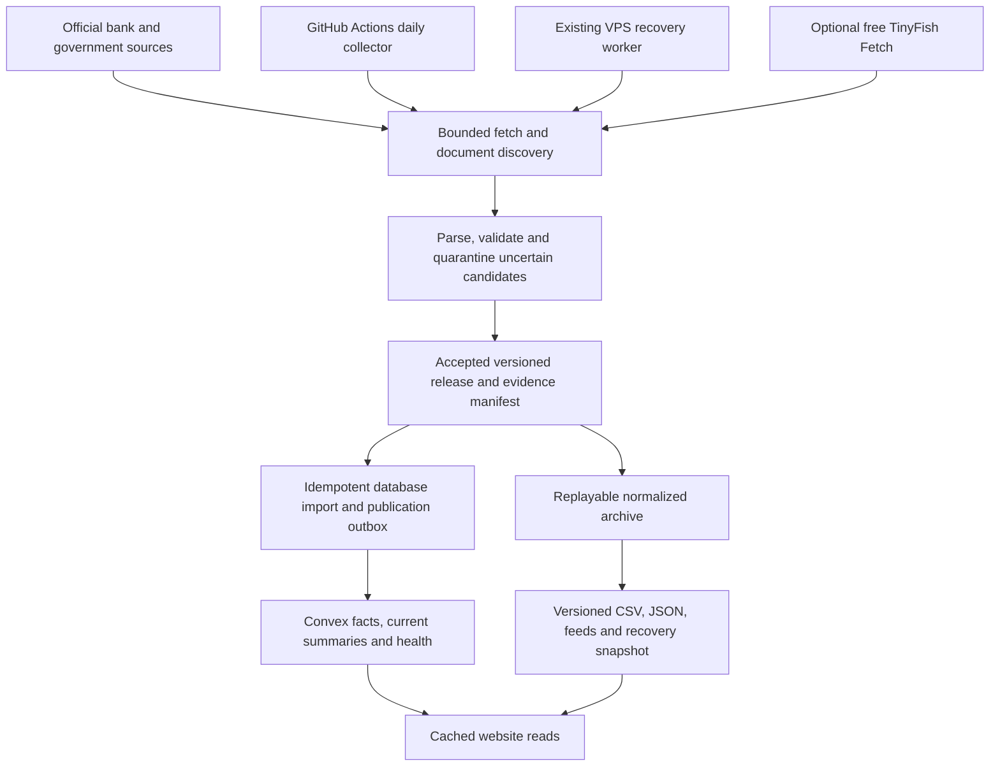

# Fixed Return Tracker action plan

Prepared 11 October 2026. This plan is for the existing `SushantKadam73/fixed-return-tracker` project. The target is reliable daily data, useful comparisons, a recoverable database and a website that runs within free allowances. Visual redesign follows those foundations.

## Recommended decisions

1. Keep Next.js, the existing Vercel deployment and Convex Free for the recovery phase. Build our own properly versioned data model on Convex. We do not need to build a database engine, and a Neon migration will not repair stopped collection.
2. Make GitHub Actions on standard Linux runners the primary collector. This repository is public, so standard hosted runner execution is free. Use direct official HTML, JSON and PDFs first. Reserve the existing VPS for scheduler recovery and difficult permitted sources.
3. Use TinyFish Search and Fetch only as optional fallback services. Disable paid Agent, Browser and Monitor operations. Initially allocate this project at most 50 attempted Fetch URLs/day and 20 Search requests/day, including retries.
4. Store accepted changes, not a new copy of every unchanged rate every day. Keep an immutable release manifest and a replayable normalized dataset outside the database. The database and website must identify the same accepted release.
5. Preserve the current 44 deposit-bank scope. All 44 should have directory entries and explicit FD/RD/savings coverage status. Compare only rates with enough verified eligibility information. The five payments banks follow in a later release, with partner FDs attributed to their actual issuer.
6. Keep bank history and merged predecessors, but display gaps and uncertainty. Refresh bank-owned archives before spending time on Internet Archive. Never turn a system-wide RBI range into a bank's exact historical offer.
7. Automate routine failures and publication retries. A redesigned table or ambiguous qualification may need an adapter correction; the site should continue serving labelled last-good data during that exception. Unreviewed AI guesses must never publish financial facts.
8. Keep the core directory, comparisons and downloads free. Investigate funding after operation is dependable. Verify hosting terms before adding commercial activity; use the already owned VPS if the current free host would require a paid commercial plan.

The infrastructure decisions and verified provider limits are documented in [zero-cost infrastructure](../research/zero-cost-infrastructure.md). Financial-data decisions and their evidence are in [official data and history](../research/official-data-and-history.md).

## What the audit established

The inspected checkout and remote `main` both resolve to `fe194cb18b93f139ca3148563cc71e38609da8a5`. The repository already contains a substantial implementation. It needs repair rather than a fresh scaffold.

| Finding | Evidence and effect | Priority |
| --- | --- | --- |
| Workflow templates are not installed | No tracked `.github/workflows`; templates are in `ops/workflows`. GitHub cannot schedule them from that location. | P0 |
| Checks stopped on 27 September | Recorded successes are about 14 days old. Current official-card coverage is FD 37/44, savings 36/44, RD 20/44, bulk FD 25/44. Missing RD data does not prove a bank offers no RD. | P0 |
| Failed operations can appear healthy | CPI fetch failures and empty RBI content report success; empty ingestion can reset source failures. Collector publication does not require a successful HTTP acknowledgment. | P1 |
| Current and future data are inconsistent | Repo import and snapshot selection can activate a future-dated card; live ingestion uses a different rule. | P1 |
| CPI updates are incomplete | The MoSPI token is obtained but never sent, known periods cannot receive revisions, and CPI Annual ends with an unexplained 192.6 to 103.5 discontinuity. The last issue needs source revalidation; its cause is not established. | P1 |
| RBI history has incorrect date semantics | The homepage observation date becomes an effective date, and reverse repo is absent from the live collector. | P1 |
| Savings returns assume unknown rules | 18 of 36 savings cards have unknown slab methods but receive numeric whole-balance estimates and rankings. | P1 |
| Live data can suppress valid fallback | A present but empty or stale Convex summary is accepted before the shipped snapshot. Incomplete initial seeding could produce this condition. Its occurrence on Vercel has not been verified. | P1 |
| Status and recovery are incomplete | The status page ignores source age and macro health. Bulk/failed runs can satisfy the daily watchdog. Browser interaction and automatic runner fallback are unfinished. | P2 |
| Data audit is not a quality gate | `npm run audit:rates` reported 15 missing cards, 10 overlaps and 4 tenure holes, but exited successfully. Some missing cards may be genuine coverage gaps; each needs classification. | P2 |
| Free-tier pressure comes from reads and rewrites | Total committed data is about 8.96 MB, but the bulk summary is already about 878 KB and summaries are rewritten unnecessarily. | P2 |

The [full project audit](../research/current-project-audit.md) has source-line citations, isolated reproductions, impact and acceptance criteria. These findings are not a claim that every existing feature is broken. Earlier environment setup passed 411 fixture/unit tests, typecheck and the production build. Those checks did not demonstrate scheduled operation or production-data freshness.

## Evidence boundary and access

The attached working notes were read as historical project context. Completion marks, dated rates and legal claims there were not treated as new instructions or independently verified facts.

The environment currently allows GitHub and package-manager destinations but blocks most official bank/provider sites, the deployed website, `mtf.trading` and Notion with a proxy CONNECT 403. That is an environment restriction, not evidence of a bank outage. Research used inspected repository code, committed official-page excerpts and reachable first-party documentation repositories. Current bank rates, live Vercel/Convex settings and the full competitor landscape remain unverified.

Specific research and registered bank-source domain additions have been saved to the environment configuration draft. Existing install/start instructions were preserved. Saving that draft did not apply network access. Review and save the environment settings, then publish the environment to activate the prepared configuration. Recheck previously blocked operations after that state change.

The Notion page could not be read or edited. This document is ready to use as the updated plan, with an answer ledger below. No claim is made that the old Notion questions have been edited.

## How the system should work

Each collector run has a distinct scope and run ID. Each accepted source revision has a semantic hash, evidence pointer and parser version. Retries can repeat a delivery safely. A database import publishes its release pointer only after the accepted batch and its summaries agree. A failure leaves the previous published version usable.

The public Git dataset is a recoverable record of accepted facts and manifests. It is not a dump of secret settings or copyrighted page copies. Keep raw evidence in bounded private storage where permitted, with immutable content hashes and document pointers. Persist enough evidence to investigate a disputed value even if the source later changes.

Website requests must not initiate scraping. Serve small cached summaries; fetch historical detail only for the selected bank/product. Publish health through a compact read model so timestamps and stale states do not require a new website build. Generate downloads and feeds from the accepted release, without additional bank requests.

## Shared quotas and zero-spend rules

The following TinyFish limits came from your message. Free Search/Fetch is confirmed in first-party documentation, but these numeric limits, their reset windows and their exact account scope could not be independently confirmed. Treat them conservatively as shared account limits until the dashboard agrees.

| Product | Your quoted limit | Proposed tracker allocation | Effect on other projects |
| --- | --- | --- | --- |
| SearchFree | 30 requests/minute and 500/hour | 20/day; at most 2/minute and 5/hour; use only for source rediscovery | Account-wide limiter still enforces both provider windows. No daily provider allowance was supplied. |
| FetchFree | 150 URLs/minute and 1,000/day | 50 attempted URLs/day; at most 20/minute; count batch URLs and retries | Tracker uses at most 5% of the quoted daily allowance, leaving up to 950/day before other projects' consumption. |
| Agent / Browser / Monitors | Separate metered products; Monitors documented at $0.005/completed run | Disabled | Search/Fetch being free does not make these operations free. |

Keep a shared reservation ledger or non-overlapping allocations across all projects. Separate API keys are not assumed to create new allowances. Reserve capacity before requests start, not only after polling provider usage. Conservatively count failed/cache/conditional attempts until their actual accounting is known. Do not enable auto-top-up or fall through to paid operations when a free limit is reached.

Daily HTTP/PDF collection consumes no TinyFish quota. The registry has 129 active sources and only 13 registered browser sources. Fetching every source through TinyFish is unnecessary. Deduplicate shared URLs and prefer bank JSON/PDF endpoints. Historical work has its own queue and cannot consume current-rate budgets.

TinyFish Fetch's documented default tolerates indefinitely cached content. Use `ttl=0` or a tested bounded age, inspect returned freshness metadata, and preserve complete headers and footnotes. A successful stale cached response must not make the product say the bank was verified today. [Evidence and exact documentation](../research/zero-cost-infrastructure.md#fetch-capabilities-that-matter-for-rates).

| Infrastructure | Evidence-based decision |
| --- | --- |
| GitHub Actions | Use standard hosted Linux runners in this public repository. Larger runners are charged. If the repo becomes private, your Pro allowance is 3,000 minutes/month shared across your private repos; artifact storage has a separate allowance. |
| Convex Free | Retrieved official docs list 0.5 GB DB, 1 GB DB I/O/month and 1 million function calls/month, generally team scope. Retain it, measure actual use and stop optional work before caps. Free and paid Starter are different plans. |
| Neon Free | Good future SQL option. Retrieved official website source lists 1 GB/project, 100 CU-hours/project/month and 5 GB transfer/project/month; verify the actual account dashboard before relying on these changing allowances. Migration follows measured need. |
| Supabase Free | Retrieved docs list two free projects, 500 MB DB/project and organization-level usage allowances. Pausing and the shared project limit add little benefit to this anonymous directory today. |
| Vercel Hobby | Retain the existing site during repair. Verify current usage, commercial terms and deployment behavior before relying on a new feature. Do not make Vercel cron the primary scraper. |
| Existing VPS | Use a lightweight watchdog and at most one browser fallback initially. Inspect spare RAM, disk, bandwidth and unrelated workloads before assigning services. Avoid a second writable database during repair. |

The [infrastructure note](../research/zero-cost-infrastructure.md#allowances-and-operational-consequences) contains pinned primary-source links, full quotas and backup limits. Allowances may be shared with your other applications; current dataset bytes are not the same as billed database storage or I/O.

## Rate tables and the data contract

The default question is: "For my deposit amount, start/maturity dates and customer eligibility, which official published FD rates apply?" Default to resident individual, INR domestic retail, general customer and verified callable deposits. Preserve other products through explicit filters.

| Dimension | Required treatment |
| --- | --- |
| Institution | Stable legal entity ID, names valid over time, current slug, predecessor/successor links. Keep the actual historical issuer. |
| Product | Distinguish ordinary FD, RD, savings, bulk, tax saver, NRE/NRO and FCNR. Currency and deposit issuer are explicit. |
| Amount | Store unit and inclusive/exclusive bounds. Thresholds and premium caps come from the source for that period. |
| Tenure | Preserve source label, days/calendar months/years, range inclusion and exact special tenures. Resolve calendar periods using the booking date. |
| Customer | Store age/category/residency restrictions and explicitly published premium formulas. Never assume every senior gets the same uplift. |
| Withdrawal/payout | Callable, non-callable and unknown are distinct. Store compounding/day-count/credit frequency and discounted monthly payout when published. Unknown eligibility does not pass an exact filter. |
| Rate | Quoted percent per annum, distinct from annualized yield. Record whether a rate is printed or derived from an explicit official premium. |
| Dates | Announcement, row/schedule effective dates, observation, last check, last verification and publication. Future versions remain pending until due. |
| Evidence | Official URL, document/table pointer, source type, content hash, parser version, completeness and date certainty. |

The existing model already represents much of this. Extend it where the audit shows information loss rather than flattening or rewriting it wholesale. Representative SBI, HDFC, ICICI, PNB, Union and SFB conditions are documented in [bank normalization research](../research/official-data-and-history.md#bank-rate-conditions-and-the-common-comparison).

The main table should show Bank, Product/scheme, Amount band, Published tenure, Customer category, Quoted rate, Withdrawal/payout, Effective from, Last verified and Official source. Filters describe the user's requested deposit. A bucket view may show the highest published rate inside that bucket, but must also show its actual tenure. A 444-day offer is not an ordinary one-year rate.

Savings need whole-balance, incremental or explicitly conditional rules, plus credit frequency. Unknown rules can still show the published slabs and source link, but must not generate an authoritative annual-interest ranking. Missing data, unsupported conditions, failed collection and verified absence of an offer need different labels.

## Ordered implementation work

Implement one phase at a time. Finish its acceptance evidence before expanding. Effort estimates below are rough focused engineering days, not delivery promises; source access and changed bank pages can dominate the work.

### Phase 0. Establish production truth and preserve the baseline

Suggested effort: half to one day. No data refresh should run blindly before the publication guards are understood.

- **FRT-001:** inspect the actual Vercel deployment SHA, Convex deployment/initial seed, GitHub workflow settings, source registry and public health. Check credential names/presence through secure settings, then test the specific read/ingestion capability. Do not put secret values in chat or documents.
- **FRT-002:** archive accepted normalized data and release hashes; record current source coverage and last-good dates. Make a baseline export and verify it can be read.
- **FRT-003:** reconcile the old working notes with implemented versus missing capabilities. Preserve known bank/history evidence and mark unverified legal/CPI claims for source confirmation.

Done when the deployed data path and its owner are identified, the existing facts are recoverable, and each reported outage has a reproducible check. Database reachability alone is insufficient.

### Phase 1. Restore safe daily collection and publication

Suggested effort: two to four days. Depends on Phase 0. This is the first working-product milestone.

- **FRT-004:** repair empty-card success, macro false-success, future/current selection and malformed read-model fallback. Share one temporal selector across live ingestion, imports, snapshots and queries.
- **FRT-005:** normalize and validate once, then publish that canonical card. Require acknowledged database delivery. Add an outbox with stable source/revision keys, bounded retries and separate collect/validate/store/publish statuses.
- **FRT-006:** install reviewed `.github/workflows/collect.yml` and CI. Pin the browser dependency reproducibly; install it only for jobs that need it. Keep manual dispatch and narrow per-bank recovery scopes.
- **FRT-007:** seed bank/source master data before summaries. Produce one release receipt matching accepted data, database summaries and website output. Verify actual Vercel behavior if data commits are expected to redeploy fallback snapshots.
- **FRT-008:** use distinct daily, bulk, macro and recovery job receipts. Daily collection defaults to 06:17 IST, with a missed-source catch-up at 12:43 IST. An optional extra bulk check at 10:20 IST uses verified applicable source/publication calendars. The old notes' claimed 2026 RBI deadline is not yet verified and must not be presented as law.

Done when a manual run and three subsequent daily runs reach the website with the same accepted data; unchanged checks advance verification without duplicate rate versions; failed ingestion remains failed; empty/future-only candidates do not replace current rates. All 44 banks have visible source/product status. A representative five-bank check validates the new path, not a reduction of the 44-bank scope.

### Phase 2. Make failures recoverable and quotas predictable

Suggested effort: two to four days. Depends on Phase 1; precedes substantial backfills.

- **FRT-009:** deduplicate same-page fetches, discover linked files from official hubs, add conditional requests and separate raw/semantic hashes. Retain footnotes and effective-date content during normalization.
- **FRT-010:** enforce one request at a time per origin initially, at least two seconds between requests, at most three total transient-failure attempts, exponential backoff/jitter, `Retry-After`, timeout and response-size limits. Apply these rules to HTML, PDF, JSON and browser routes.
- **FRT-011:** add per-source circuit breakers and an explicit fallback ladder: direct official endpoint, alternate official file, local bounded browser, optional TinyFish Fetch, then deferred retry. Access denials or captchas do not authorize bypass. Source failure cannot consume another project's quota.
- **FRT-012:** reuse a small browser pool with source-specific waits/clicks. Restore the unrun browser sources and Suryoday tab interaction. Start with one browser on the 2 GB VPS; expand only after measurement.
- **FRT-013:** expose age-aware bank and macro status, expected publication periods, last validated/published release, rejected candidates, source gaps and next retry. Alert only on transitions or unresolved escalation, deduplicating repeated failures.
- **FRT-014:** optional VPS watchdog checks completed scope-specific receipts, acquires an expiring lease before recovery and avoids racing GitHub. Recover a missed daily run even when the bulk job succeeds. Use a least-privilege dispatch credential; never fabricate keepalive data commits.
- **FRT-015:** budget dashboard/storage/I/O and weekly bounded exports. Warn at 50%, stop optional/backfill work by 75%, and retain safety headroom. Provider shared-account/team use is included.

Done when simulated 429, timeout, 403, changed layout, exhausted TinyFish budget, DB outage and missed schedule preserve last-good data and truthful status. Prove a restoration with counts, hashes, effective dates and website rows. Routine daily operation should complete for 14 days without intervention; exceptions remain visible, not invented away.

### Phase 3. Complete current bank tables and repair existing utilities

Suggested effort: three to seven days, source-dependent. Depends on Phases 1 and 2.

- **FRT-016:** build a 44-bank product/criteria matrix from official pages. Resolve the seven banks without current FD cards and eight without savings cards. RD/bulk/tax-saver absence requires evidence or an explicit unknown/blocked status, not inferred equality with FD.
- **FRT-017:** fix the audit's overlaps and tenure holes against source wording. Preserve calendar-unit boundaries and row-level effective dates. Quarantine lending/yield/wrong-residency tables and missing source sections.
- **FRT-018:** enforce customer, amount, residency, callable and payout eligibility. Add explicit unknown outcomes; keep special schemes discoverable. Test a source row at every inclusive/exclusive threshold and around leap years.
- **FRT-019:** verify all savings slab methods and credit frequencies. Model conditional rules or declare their unsupported amount range. Remove unsupported numeric rankings immediately rather than waiting for full coverage.
- **FRT-020:** calibrate FD/RD/payout calculators against representative official policies/calculators. Use booking/maturity dates and bank conventions where known; retain a clearly labelled generic estimate otherwise. Check zero-rate and boundary inputs.
- **FRT-021:** separate accrued and credited PPF/EPF interest, enforce sourced contribution constraints and label future-return assumptions. Preserve retirement simulation as an estimate rather than a promised return.
- **FRT-022:** split oversized aggregates by bank/product/amount tier; rewrite only changed summaries/imports. Avoid full history downloads on every comparison request.

Done when supported comparison results satisfy all selected conditions, source tables and exports reconcile, no uncertain savings method is silently ranked, and actionable audit errors fail CI. Every bank retains a useful official-page directory entry even if some automation is still blocked. Do not advertise verified rates for all 44 until actual coverage warrants it.

### Phase 4. Repair RBI and inflation collection

Suggested effort: two to four days. Can proceed alongside Phase 3 after safe publication exists.

- **FRT-023:** collect and label repo, fixed reverse repo, SDF, MSF, Bank Rate, CRR and SLR. Reserve ratios are not deposit yields. Use the homepage for current-value cross-checks and notifications/MPC statements for actual effective dates.
- **FRT-024:** verify the current MoSPI API/manual, implement supported authentication without credential leakage, pagination, Combined/all-India filters and latest-period completeness. If the API is unavailable, discover official releases/downloads as a fallback.
- **FRT-025:** allow provisional-to-final and corrected observations as revisions. Keep original period, base, source, vintage and supersession. Validate the CPI discontinuity before using that series in calculations.
- **FRT-026:** retain separate CPI Combined, Rural, Urban and CPI-IW series. Link base changes only using verified official methodology for that series. Do not silently splice CPI-IW into CPI Combined.
- **FRT-027:** store RBI inflation forecasts with publication date, target period and forecast vintage, separately from subsequently measured CPI. Expose a simple policy/inflation page with historical downloads and source links.

Done when the latest expected official release is verified or clearly marked delayed/unavailable, all seven policy/reserve series are covered, unchanged values remain checked without new events, revisions are retained and dates/units/bases are correct.

"Government-announced inflation" should mean published measured CPI, with its reference month and provisional/final status. "Real return" is the purchasing-power result of a stated deposit return and selected inflation measure. A personal spending-basket estimate can follow later. There is no single separately observable true inflation number for every citizen. Use `(1 + nominal return) / (1 + inflation) - 1` for aligned annual periods, or compatible CPI index ratios for purchasing-power comparisons.

### Phase 5. Extend historical evidence and merged-bank coverage

Suggested effort: one to two weeks for a useful first expansion; ongoing thereafter. Depends on stable current data and separate backfill budgets.

- **FRT-028:** renew bank-owned SBI, HDFC and PNB historical files first. Existing SBI FD history contains 101 cards, of which 91 are bank archives; HDFC and PNB also have substantial bank-owned evidence. Preserve original amount thresholds and customer scope.
- **FRT-029:** research each bank's official old-rate pages/circulars, investor-relations archives and explicit annual-report rate facts. Inspect NSE/BSE filings where relevant. Cost-of-deposits averages are not customer rate cards.
- **FRT-030:** use RBI Handbook/Bulletin/DBIE and original notifications for policy history and regulated-era context. Keep annual ranges, ceilings and end-March snapshots as those metrics; do not fabricate daily bank-specific schedules.
- **FRT-031:** use Internet Archive, Common Crawl and Arquivo.pt as capture discovery routes, recording capture versus effective dates. Coverage at alternative archives is a research lead, not yet established for these banks.
- **FRT-032:** evaluate Kaggle/open repositories only after checking publisher, original evidence, time semantics, dimensions, licence and a sampled reconciliation with official records. Reject unsourced highest-rate CSVs as production truth.
- **FRT-033:** verify lineage from bank/RBI/Gazette evidence. Keep predecessor identity, legal change type and date. A merger does not mean an existing contracted deposit immediately changes to the successor's newly offered rate.
- **FRT-034:** accept historical candidates through staging and source-cell review. Publish per-bank/product coverage start, gaps, date certainty and evidence type. Never carry a rate through an unobserved historical interval by interpolation.

Done when every accepted history observation has reproducible evidence and temporal meaning, predecessor charts retain issuer identity and coverage labels, and backfills do not impair daily current checks. Founding-to-present complete history for every bank is an aspiration, not a guarantee of recoverable records.

### Phase 6. Add the useful publication layer

Suggested effort: two to four days after existing pages pass their checks.

- **FRT-035:** update methodology with source order, eligibility, normalization, dates, correction policy, freshness, missingness and calculator assumptions. Version it with the dataset.
- **FRT-036:** publish current and historical CSV/JSON with schema version, release hash, provenance and dates. Exports and website rows must match the same release.
- **FRT-037:** add deduplicated RSS/Atom and JSON change feeds. Daily unchanged checks do not create rate-change stories. Begin with a short daily change log and weekly recap; reuse stored events.
- **FRT-038:** add observed highs/lows and records only for explicitly covered periods. Never claim "highest ever" from incomplete history. Keep the official-source directory useful without accounts or booking flows.
- **FRT-039:** complete the live comparator and `mtf.trading` inspection after access is restored. Adapt helpful reporting patterns; do not add empty daily/monthly/sector pages merely to mirror navigation.

Done when a reader can locate an official rate page, reproduce a comparison and download its supporting facts without signing in. Feeds/reports require no new scraping and reconcile to accepted releases.

### Phase 7. Improve presentation and assess funding

Start after dependable collection, correct filters and useful pages are established.

- **FRT-040:** improve mobile tables, accessibility, search/filter clarity, loading and stale/error states, then visual style. Avoid hiding source dates or eligibility to make a card look simpler.
- **FRT-041:** measure actual audience and utility without creating an expensive account/marketing stack. Core pages remain anonymous and read-only.
- **FRT-042:** consider voluntary GitHub Sponsors support, a clearly labelled maintenance sponsor, and only then documented affiliate programmes or advertisements. GitHub's official source lists India as a supported Sponsors region; approval and recipient setup still apply.
- **FRT-043:** verify commercial hosting permission and written provider terms before activation. If a paid host is required, evaluate the already owned VPS or an explicitly compatible free host. Do not weaken rankings or buy infrastructure to justify monetization.

Done when presentation helps a reader choose applicable criteria and every funded relationship is disclosed. No revenue amount or affiliate eligibility is assumed. No paid feature is required for the project to function.

## Decisions ready to transfer to Notion

The exact old Notion question text was unavailable. This ledger answers the known topics from the working notes and current request; it does not invent question IDs.

| Topic | Answer |
| --- | --- |
| Bank scope, known as BANK-02 in the notes | Keep 44 deposit-issuing banks for recovery and launch; retain 39 predecessor entries. Add payments-bank savings/partner FD offerings later with issuer attribution. Renew the RBI roster rather than assuming old counts stay current. |
| TinyFish, known as COM-03 | Optional Search/Fetch fallback only, initially 50 Fetch URLs/day and 20 Search requests/day. Confirm the account's numeric quotas. Do not use paid Monitors/Agent/Browser. |
| Database | Keep our versioned data model on existing Convex Free initially. Neon is the preferred SQL migration candidate if measured quotas or historical query needs justify the work. |
| Scheduler | Active GitHub workflows, scope-specific receipts and a missed-run recovery path. Existing VPS watchdog is the independent fallback, with a shared lease. |
| Common comparison | Source-exact amount, maturity, customer, residency, withdrawal, payout and dates. Common buckets help discovery but do not erase special-tenure eligibility. |
| Savings calculation | Verified whole/incremental/conditional methods and credit frequency. Unknown means insufficient calculation evidence. |
| Inflation | Separate measured CPI series, CPI-IW, RBI forecast vintages and optional personal-basket estimates. Verified base changes; no silent population/basket splice. |
| Historical sources | Official bank archives first, then official documents/filings/RBI context, then web captures and clearly labelled secondary partial evidence. Kaggle is a candidate source to validate, not authority by default. |
| Merged banks | Retain actual issuer and dated lineage. Separate rename, merger and licence conversion; do not rewrite predecessor offers as successor rates. |
| Autonomous operation | Daily checks, bounded retries, fallback, publication outbox, correct freshness and restore-tested archives. Rare parser ambiguity can still require maintenance. |
| Public utility | Official-page directory, applicable-rate tables, repaired calculators/history/status, methodology, reconciled downloads and change feeds before visual redesign. |
| Monetization | Future maintenance support and verified referral/sponsor options, with hosting permission and separate placements. Keep public data and ranking free. |

## Completion dashboard for the first workable release

- An installed workflow successfully updates a representative official card and website row; three scheduled runs and a missed-run recovery are evidenced.
- All 44 banks have product-level published/missing/blocked/unsupported status. Confirmed current coverage is stated numerically, never inferred from registration count.
- Empty, partial, future-only and failed candidates cannot overwrite current accepted data or produce false health.
- Collection, database import, website read model and exports reconcile by release ID/hash.
- Exact filters and savings calculations do not silently use unknown eligibility/rules.
- Official RBI/CPI latest-publication checks, revisions, date/base/units and failures work.
- A database outage, provider cap and source outage retain labelled last-good data.
- A normalized archive restore reproduces counts, hashes and visible results.
- Fourteen days of automatic operation demonstrate the routine path; outstanding source exceptions are named and visible.
- No paid operation, larger runner, auto-top-up or required paid plan is part of normal operation.

## Remaining source verification

The code audit and pinned provider-document research are complete for this planning pass. The following external verification is still required and must not be described as completed research:

1. Actual production deployment settings, current official bank source contents and relevant service account allowances.
2. Current TinyFish numeric quotas, reset/error accounting and actual returned fetch freshness.
3. Current Vercel Hobby terms and bot-authored deployment behavior.
4. Exact RBI notices behind the old notes' 2026 bulk deadline and deposit-rule claims; exact CPI rebasing/linking documents; statutory/tax/insurance rules used in future calculators.
5. Live `mtf.trading`/commercial comparator capabilities, candidate Kaggle datasets and archive coverage.
6. Read access to the original Notion questions and authorized write access before claiming a synchronized Notion plan.

Read the supporting [project audit](../research/current-project-audit.md), [infrastructure research](../research/zero-cost-infrastructure.md), [official data/history research](../research/official-data-and-history.md) and [product/sustainability research](../research/product-and-sustainability.md) for sources, facts versus recommendations and implementation constraints.
